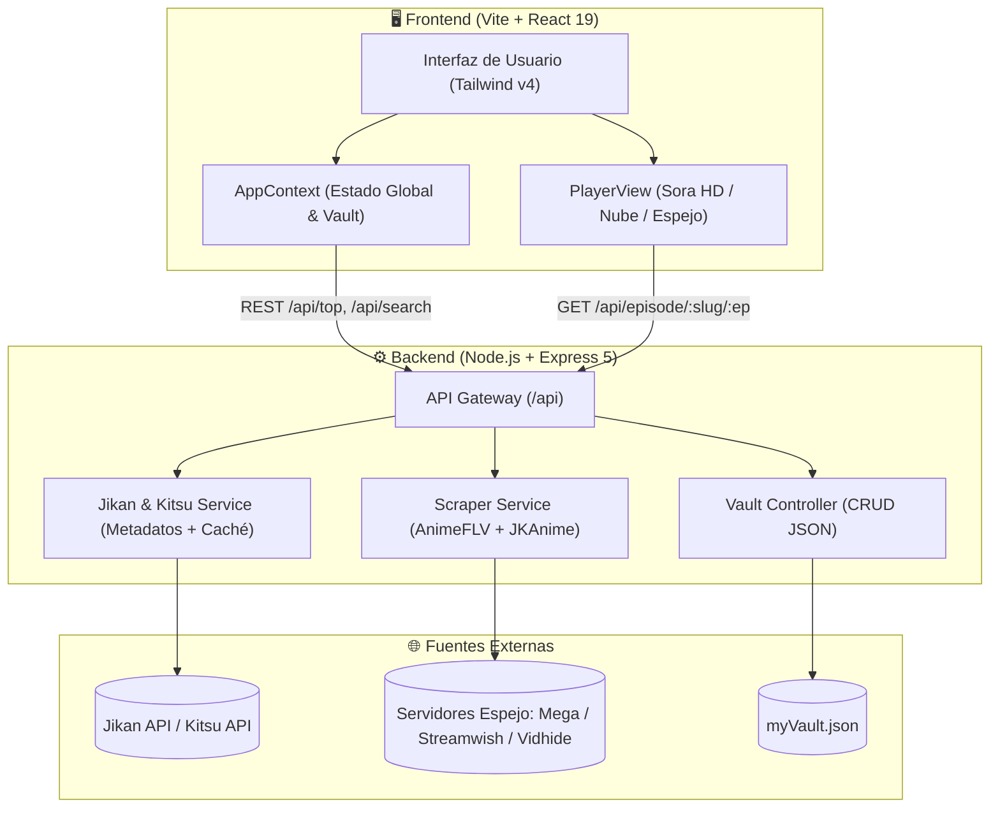

# 🌌 Sora Anime (AnimeDex)

<div align="center">


<br/>

**Tu portal de anime personal, elegante y con streaming infalible.**  
Diseñado con una estética moderna en tonos oscuros y *glassmorphism*, impulsado por React 19, Tailwind CSS v4, Express y un extractor multi-servidor en tiempo real (AnimeFLV / JKAnime).

[](https://react.dev/)
[](https://vitejs.dev/)
[](https://tailwindcss.com/)
[](https://expressjs.com/)
[](#)

[Características](#-características-principales) •
[Arquitectura](#-arquitectura-del-sistema) •
[Estructura](#-estructura-del-proyecto) •
[Instalación](#-instalación-y-despliegue)

---

</div>

## ✨ Características Principales

- 🎬 **Extractor de Servidores Espejo (Camino 1)**: Extracción directa de reproductores limpios (Streamwish, Mega, Vidhide, VOE, Filemoon) desde fuentes en español (AnimeFLV / JKAnime).
- 🎛️ **Triple Servidor en Reproductor**: Selector integrado con botones **Sora HD** (Principal · 1080p), **Nube** (Alternativo · 720p) y **Espejo** (Respaldo · 480p). Si un servidor se satura, cambias al siguiente al instante sin salir de la app.
- 🚫 **Zero Banners & Zero Pop-ups**: Los enlaces de video se extraen en el backend y se cargan limpios dentro de la interfaz de Sora Anime, sin redirecciones ni anuncios molestos.
- 🎨 **Interfaz Cyber-Glassmorphism**: Tema oscuro refinado, efectos de desenfoque (*backdrop-blur*), atajos de teclado y diseño 100% responsivo para móviles y escritorio.
- ⚡ **Catálogo & Metadatos Resilientes**: Consulta de tops, sinopsis, rankings y recomendaciones a través de **Jikan API v4 (MyAnimeList)** con sistema de contingencia instantáneo (**Kitsu API**) y caché en memoria con TTL.
- 🔒 **Bóveda Personal (*My Vault*)**: Guarda y gestiona tu colección localmente con persistencia inmediata en el backend (`myVault.json`).

---

## 🏛 Arquitectura del Sistema



---

## 📁 Estructura del Proyecto

```text
Anime_dex/
├── backend/                  # Servidor de API y extractor de streams
│   ├── src/
│   │   ├── config/
│   │   │   └── constants.js  # Headers HTTP y URLs base
│   │   ├── controllers/
│   │   │   ├── streamController.js # Búsquedas, tops y controlador de episodios
│   │   │   └── vaultController.js  # CRUD de la bóveda del usuario
│   │   ├── data/
│   │   │   └── myVault.json  # Base de datos local
│   │   ├── routes/
│   │   │   └── animeRoutes.js# Rutas REST (/api/top, /api/search, /api/episode)
│   │   └── services/
│   │       ├── jikanService.js    # Metadatos con caché y fallback
│   │       └── scraperService.js  # Extracción multi-servidor (AnimeFLV / JKAnime)
│   ├── index.js              # Servidor Express (Puerto 4000)
│   └── package.json
│
├── frontend/                 # Aplicación de cliente SPA
│   ├── src/
│   │   ├── components/       # Componentes modulares
│   │   │   ├── AnimeCard.jsx # Tarjeta de anime con estados y badges
│   │   │   ├── Hero.jsx      # Carrusel interactivo principal
│   │   │   ├── Navbar.jsx    # Búsqueda en tiempo real y navegación
│   │   │   └── PlayerView.jsx# Reproductor multi-servidor (Sora HD, Nube, Espejo)
│   │   ├── context/          # AppContext (estado global, progreso y colección)
│   │   ├── data/             # Generadores de arte vectorial SVG
│   │   ├── lib/              # Cliente HTTP centralizado hacia el backend
│   │   ├── pages/            # Vistas (Home, Explore, Search, Detail, Collection, Profile)
│   │   ├── App.jsx           # Enrutamiento de la aplicación
│   │   └── main.jsx
│   ├── vite.config.js
│   └── package.json
│
└── README.md
```

---

## 🚀 Instalación y Despliegue

### Requisitos Previos
- **Node.js**: v18.0.0 o superior
- **npm**

### 1. Iniciar el Backend
```bash
cd backend
npm install
npm run dev # o npm start
```
> El servidor arrancará en `http://localhost:4000`.

### 2. Iniciar el Frontend
En una nueva terminal:
```bash
cd frontend
npm install
npm run dev
```
> La aplicación estará disponible en `http://localhost:5173`.

---

## 📄 Licencia

Este proyecto está bajo la licencia **ISC**.
Desarrollado con ❤️ para los amantes del anime que buscan velocidad, respaldo múltiple y buen diseño.
