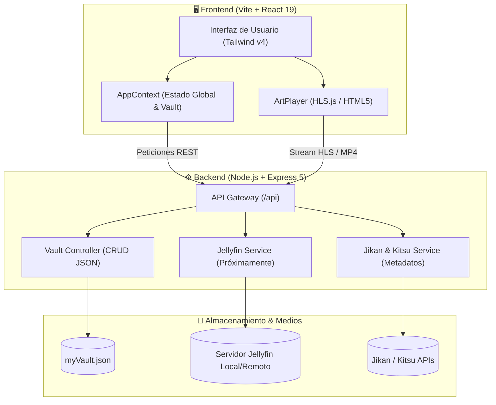

# 🌌 Sora Anime (AnimeDex)

<div align="center">


<br/>

**Tu portal de anime personal, elegante y autocontenido.**  
Diseñado con una estética moderna en tonos oscuros y *glassmorphism*, impulsado por React 19, Tailwind CSS v4, Express y arquitectura preparada para **Jellyfin**.

[](https://react.dev/)
[](https://vitejs.dev/)
[](https://tailwindcss.com/)
[](https://expressjs.com/)
[](https://artplayer.org/)
[](https://jellyfin.org/)
[](#)

[Características](#-características-principales) •
[Arquitectura](#-arquitectura-del-sistema) •
[Estructura](#-estructura-del-proyecto) •
[Instalación](#-instalación-y-despliegue) •
[Plan de Migración](#-plan-de-migración-a-jellyfin)

---

</div>

## ✨ Características Principales

- 🎨 **Interfaz Cyber-Glassmorphism**: Experiencia de usuario inmersiva con tema oscuro, efectos de desenfoque (*backdrop-blur*), transiciones ultrarrápidas y diseño 100% responsivo para móviles y escritorio.
- ⚡ **Catálogo & Metadatos Resilientes**: Consulta de tops, sinopsis, rankings y recomendaciones a través de **Jikan API v4 (MyAnimeList)** con sistema de contingencia instantáneo (**Kitsu API**) para evitar bloqueos por rate-limiting.
- 🔒 **Bóveda Personal (*My Vault*)**: Guarda y gestiona tu colección localmente con sincronización persistente en el backend (`myVault.json`).
- 🛡️ **Zero-CORS & Backend Proxy**: El frontend nunca expone credenciales ni hace peticiones directas a APIs de terceros; todo el tráfico se centraliza y optimiza en el servidor Express.
- 📺 **Reproductor Multimedia ArtPlayer**: Integración de streaming con soporte para HLS adaptativo (`.m3u8`), MP4 nativo, selector de calidad, atajos de teclado y subtítulos.
- 🏠 **Arquitectura Autoalojada (Preparada para Jellyfin)**: Olvídate de pop-ups, acortadores y servidores caídos. Diseñado para consumir tu propia biblioteca multimedia local o remota a través de Jellyfin Media Server.

---

## 🏛 Arquitectura del Sistema



---

## 📁 Estructura del Proyecto

```text
Anime_dex/
├── backend/                  # Servidor de API y lógica de negocio
│   ├── src/
│   │   ├── config/
│   │   │   └── constants.js  # Rutas y configuración de puertos
│   │   ├── controllers/
│   │   │   ├── streamController.js # Búsquedas, top animes y metadatos
│   │   │   └── vaultController.js  # Gestión de la colección del usuario
│   │   ├── data/
│   │   │   └── myVault.json  # Base de datos local en JSON
│   │   ├── routes/
│   │   │   └── animeRoutes.js# Rutas REST de la aplicación
│   │   └── services/
│   │       ├── jikanService.js    # Metadatos con fallback Kitsu
│   │       └── jellyfinService.js # (Fase 3) Integración con Jellyfin
│   ├── index.js              # Punto de entrada de Express
│   └── package.json
│
├── frontend/                 # Aplicación de cliente SPA
│   ├── src/
│   │   ├── components/       # Componentes modulares (AnimeCard, Navbar, Modales)
│   │   │   └── player/       # Integración con ArtPlayer
│   │   ├── context/          # Estado global de la aplicación (AppContext)
│   │   ├── data/             # SVGs y utilidades de renderizado
│   │   ├── lib/              # Cliente HTTP hacia el backend
│   │   ├── pages/            # Vistas principales (Home, Search, Detail, Vault)
│   │   ├── App.jsx           # Enrutamiento principal
│   │   └── main.jsx
│   ├── vite.config.js
│   └── package.json
│
└── README.md
```

---

## 🚀 Instalación y Despliegue

### Requisitos Previos
- **Node.js**: v18.0.0 o superior
- **npm** o **pnpm** / **yarn**

### 1. Clonar el Repositorio
```bash
git clone https://github.com/tu-usuario/anime-dex.git
cd anime-dex
```

### 2. Configuración del Backend
```bash
cd backend
npm install
npm run dev
```
> El backend quedará ejecutándose en `http://localhost:4000`.

### 3. Configuración del Frontend
En una nueva terminal:
```bash
cd frontend
npm install
npm run dev
```
> El cliente web estará disponible en `http://localhost:5173`.

---

## 🗺️ Plan de Migración a Jellyfin

El proyecto se encuentra en una transición organizada hacia un reproductor privado autoalojado:

- [x] **Fase 1: Limpieza & Unificación**
  - Desinstalación de herramientas de scraping frágiles y módulos obsoletos.
  - Unificación de tarjetas de anime por metadatos únicos.
  - Proxy centralizado de peticiones de catálogo en Express.
- [ ] **Fase 2: Configuración de Entorno & Seguridad**
  - Variables de entorno (`.env` y `.env.example`) para Jellyfin (`URL`, `API_KEY`, `USER_ID`).
  - Estandarización de `VITE_API_BASE` en el frontend.
- [ ] **Fase 3: Servicio de Streaming Jellyfin**
  - Endpoint `/api/jellyfin/match` para emparejar títulos de MyAnimeList con IDs de Jellyfin.
  - Listado dinámico de temporadas, episodios e información de duración.
  - Generación de URLs de reproducción HLS/transcodificación adaptativa.
- [ ] **Fase 4: Integración Completa de ArtPlayer**
  - Selector de servidor, calidad y pistas de subtítulos dentro de la interfaz de Sora.
  - Sincronización del progreso de reproducción en Jellyfin.

---

## 🛠️ Tecnologías Utilizadas

| Capa | Tecnologías |
| :--- | :--- |
| **Frontend** | React 19, Vite, Tailwind CSS v4, React Router 7, Lucide Icons |
| **Reproductor** | ArtPlayer, HLS.js |
| **Backend** | Node.js, Express 5, Axios, CORS, Dotenv |
| **Metadatos** | Jikan API v4 (MyAnimeList), Kitsu API v2 |
| **Streaming** | Jellyfin Media Server API |

---

## 📄 Licencia

Este proyecto está bajo la licencia **ISC**. Consulta el archivo de licencia para más detalles.

<div align="center">
  <sub>Desarrollado con ❤️ para los amantes del anime que buscan velocidad, privacidad y buen diseño.</sub>
</div>
